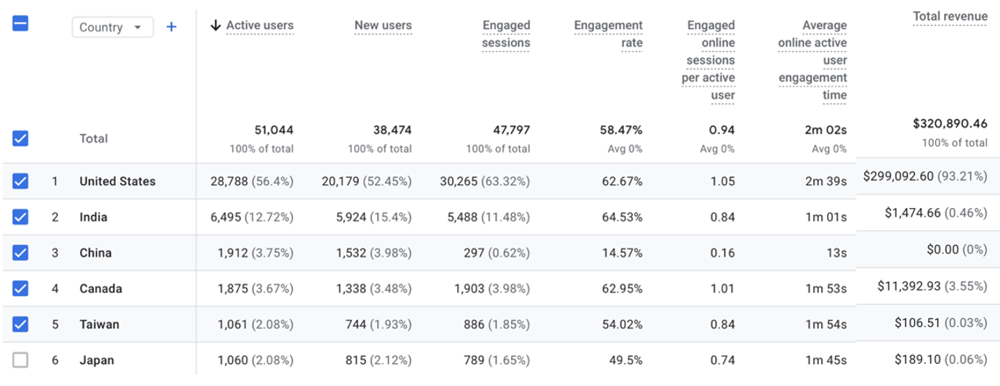
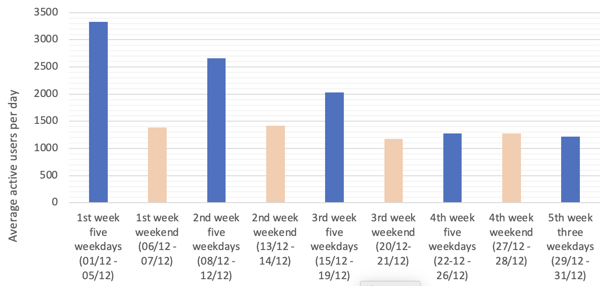
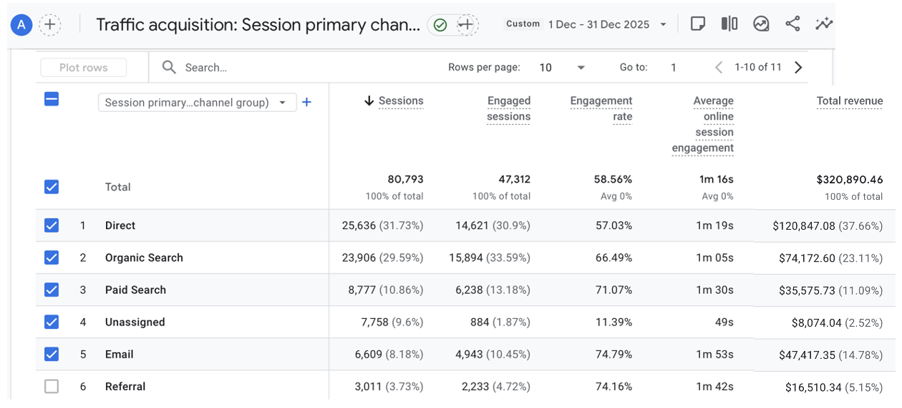
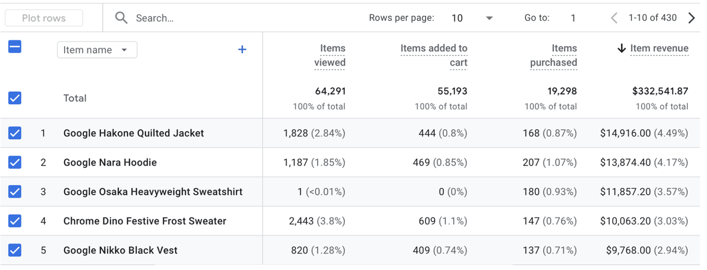

# Google Merchandise Store Web Marketing Analytics

Analysis of web traffic and user behaviour for the Google Merchandise Store (December 2025) to identify conversion drop-offs and recommend improvements.

📄 **[Read the full report (PDF)](report/Google-Merch-Store-Web-Analytics-Report.pdf)**

## Business Problem
The store attracts around 50,000 active users a month, but only about 2.6% of sessions end in a purchase. Where do users drop off and what should the business change to improve engagement, conversion and revenue?

## Data
- **Source:** Google Analytics 4 demo account for the Google Merchandise Store (publicly available)
- **Period:** 01/12/2025 – 31/12/2025
- **Scale:** ~50,000 active users, ~38,000 new users, 80,793 sessions, $320,890.46 revenue
- **Collection:** Data was extracted manually from GA4 reports (audience, acquisition, behaviour and conversion). The charts were built in Excel.

## Tools Used
Google Analytics 4, Microsoft Excel

## Approach
- Analysed four areas of the customer journey: audience, acquisition, behaviour and conversion
- Compared engagement and revenue by country and by traffic channel to separate high-volume from high-quality traffic
- Compared weekday and weekend activity to find traffic patterns
- Built the conversion funnel from product list view → product view → add to cart → purchase to locate drop-offs
- Suggested recommendations covering 5 areas.

## Key Findings
**Audience**
- The United States has more than four times the active users of India (the second-largest market) and contributes 93.2% of total revenue
- India has a higher engagement rate (64.5%) than the US (62.7%) but generates only 0.46% of revenue
- Activity is consistently higher on weekdays than at weekends

**Acquisition**
- Direct (31.7%) and organic search (29.6%) bring the most traffic, while paid search brings 10.9%
- Email (74.8%) and referral (74.2%) have the highest engagement rates, compared with 57.0% for direct and 66.5% for organic search
- Email generates a larger share of revenue (14.8%) than paid search (11.1%) despite far less traffic

**Behaviour and conversion**
- 1.47 million events, averaging 29 events per user, with 2 min 2 sec average engagement time
- Only 17.7% of product list views lead to a product page view (368K list views vs 65K item views)
- 86% of product views lead to add-to-cart, but only 35% of carts convert to purchase, pointing to a checkout problem
- Estimated conversion rate of about 2.6%, with an average order value of $151

## Visuals

*Active users, engagement rate and revenue by country*

*Average daily active users on weekdays and weekends*

*Traffic share, engagement rate and revenue by channel*

*View-to-cart and cart-to-purchase funnel*

## Recommendations
1. **Optimise the checkout process:** simplify the flow, and check which user groups abandon at the purchase step and whether unexpected tax or shipping costs are the cause
2. **Improve the product page layout:** use better product images and descriptions, show reviews or ratings on product tiles, and add social proof such as how many people viewed an item today, to lift the 17.7% click-through
3. **Scale high-performing channels:** run email campaigns with personalised first-purchase offers, and partner with blogs, influencers and review sites to grow referral traffic
4. **Improve traffic quality:** refine SEO and paid keywords, remove irrelevant paid terms and A/B test adverts to raise engagement from direct, organic and paid traffic
5. **Expand to new markets:** localise language, currency and offers for engaged markets such as India, starting with a small test to confirm they convert as well as they engage

## Author
Hashen Rathnayake | [LinkedIn](https://www.linkedin.com/in/hashen-rathnayake-074885207/)
